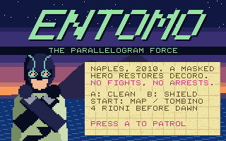
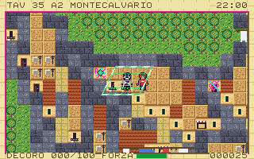
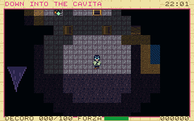
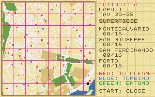
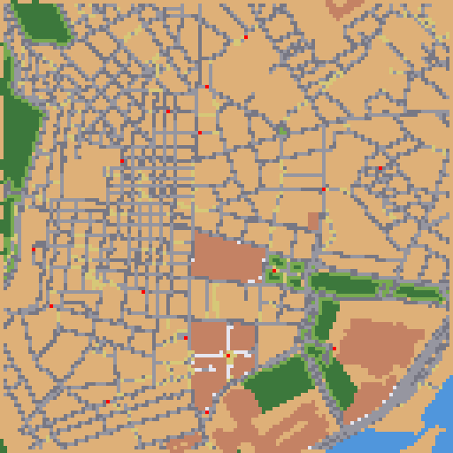
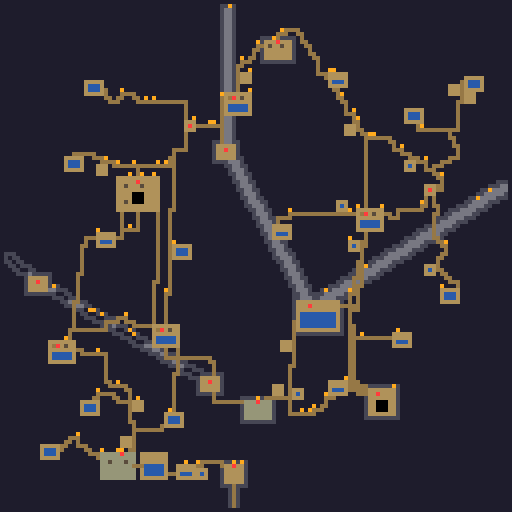

# Entomo: The Parallelogram Force

*Naples, 2010. A masked civic hero restores decoro to his city: no fights, no
arrests.*

A cartridge for [PRG32](https://github.com/riscv-prg32/PRG32), the
educational RISC-V console (ESP32-C6, 320x200, RV32IMC), and a tribute to
Entomo, the Real Life Super Hero who has patrolled Naples since 2009.

 

 

A 23-second capture from the PRG32 QEMU firmware, with sound:
[assets/store/preview.mp4](assets/store/preview.mp4).

## The game

One night, from 22:00 to dawn at 06:00 (15 minutes of play), to bring the
**Decoro Index** of four rioni to 100: Montecalvario, San Giuseppe, San
Ferdinando and Porto. Each has sixteen jobs: graffiti to scrub off the tuff
walls, rubbish to gather, broken glass to clear. Thirteen are in the streets,
three in the cavities under them.

| Input | Action |
| --- | --- |
| D-pad | Walk |
| A (hold) | Clean the job in front of the hero |
| B (hold) | The Parallelogram Force shield (drains FORZA, recharges when released) |
| SELECT on a manhole or a staircase | Change layer: streets or cavities |
| START anywhere else | The Tuttocitta atlas overlay |

SELECT and START are the same physical button on PRG32, so the button is
contextual. A blinking lozenge points to the nearest job, or to the nearest
manhole when the current layer is clean.

**Strictly non-violent.** Teppistelli and guardiamacchine walk the streets.
With the shield up they bounce off it (their velocity is inverted and
doubled); without it a contact only makes the clock jump eight minutes
ahead. There is no health, for anybody. When a rione reaches 100 its
troublemakers settle down for good, one with a book, one with a flower pot.

More in [docs/gameplay.md](docs/gameplay.md).

## The two maps

The surface is the real street layout, derived tile by tile from plates
35-38 of the *Tuttocitta Napoli* street atlas: Quartieri Spagnoli, Via
Toledo, the lower cut of Spaccanapoli (Via Pasquale Scura), Galleria
Umberto I, Piazza Municipio, Maschio Angioino, Molo Beverello. One atlas
square is exactly 16x16 game tiles (about 9.4 m per tile), so the reference
shown on screen, for example `TAV 35 C3`, is the one printed in the atlas.

The subterranean layer lies exactly beneath it, tile for tile: aqueduct
galleries that follow the streets above, cisterns, a tuff quarry, an
air-raid shelter, the Linea 1 building sites of 2010, the funicular tunnel.
Sixteen shafts join the layers, each a manhole above and a staircase below
on the same tile.

| Surface (128x128) | Subterranean (128x128) |
| --- | --- |
|  |  |

Sources, method and what is documented versus generated:
[docs/maps.md](docs/maps.md). The atlas itself is copyrighted and is not in
this repository; only the derived grid is.

## What it uses of PRG32

- **Indexed framebuffer and palette API (ABI 1.5)**: 96 exact colours on
  every host, colour cycling for the neon shield, the torches and the water.
- **Compact indexed sprites (ABI 1.3)**: the cartridge composes three
  parallax layers itself and submits the playfield as eleven 8-bit strips.
- **SID-like synthesiser, eight voices, stereo**: five tracker tunes with
  the band laid out across the stereo field; effects panned to where they
  happen on screen; under ground every effect returns as two echoes thrown
  to opposite sides.
- **Status bands, score service, Store metadata and colophon.**
- **Portable ABI-table cartridge**: one image, position independent, no
  required features.

Design and budgets: [docs/architecture.md](docs/architecture.md),
[docs/audio.md](docs/audio.md).

## Build

```bash
tests/run_tests.sh shots       # host tests (no RISC-V toolchain needed)
scripts/build.sh               # dist/entomo-esp32c6.prg32, dist/entomo-qemu.prg32
scripts/pack-store-bundle.sh   # dist/entomo-1.0.0-store.zip
scripts/check_hosts.sh         # PRG32-QT core and QEMU firmware
```

Needs a PRG32 checkout next to this one (or `PRG32_REPO`), the
`riscv32-esp-elf` toolchain of ESP-IDF, Python 3 with Pillow.

| Budget | Used | Limit |
| --- | ---: | ---: |
| Cartridge package (code, audio, Store trailer) | 60,049 | 65,536 |
| Executable RAM (code, data, bss) | 50,972 | 65,536 |
| Load image (header, code, audio) | 47,996 | 54,500 |

Run it:

```bash
cd ../PRG32
python3 -m prg32 qemu upload ../EntomoTheParallelogramForce-napoli2010/dist/entomo-qemu.prg32
python3 -m prg32 qemu run
```

```bash
cd ../PRG32
python3 -m prg32 esp32c6 upload ../EntomoTheParallelogramForce-napoli2010/dist/entomo-esp32c6.prg32 --url http://192.168.4.1
```

Testing: [docs/testing.md](docs/testing.md). Publishing:
[docs/store_publishing.md](docs/store_publishing.md).

## Credits

Concept, story and design brief: Raffaele Montella (UniParthenope). Game
design, programming, pixel art, music and tooling: Claude Code (Anthropic).
The hero sprite follows the photographs of the real costume. This is a fan
tribute and is not endorsed by Entomo; the events of the game are fiction,
the streets are real.

MIT licence. All graphics are drawn by code and all sound is synthesised:
no photographs and no samples are distributed.
